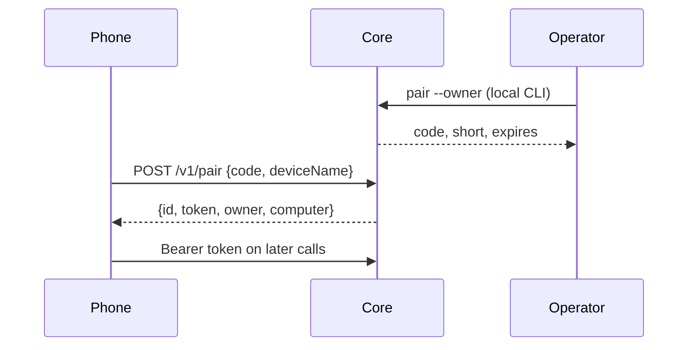

# Pairing protocol

Platform-neutral contract for pairing a phone with Nova Core. iPhone and Mac implement it today. Android and Windows can use the same messages later; they are not implemented.

## Transport

Core listens only on loopback. Remote access is Tailscale Serve over HTTPS to the tailnet. There is no unauthenticated public service. Funnel is detected and warned about; Nova never enables it.

## Invitation

- One invitation, two redeemers: a 144-bit QR secret (`code`) and an 8-character Crockford base32 short code (`ABCD-1234`).
- Short codes forgive case, spaces, dashes, and O/I/L look-alikes (`O→0`, `I/L→1`).
- Expires in 10 minutes. Single use. Redeeming either form spends the invitation.
- Owner invitations can only be created on the computer (`pair --owner` or the Mac toggle). Redeeming one sets `computer_owner`.
- After 10 wrong codes in 10 minutes, Core returns 429 for 10 minutes and cancels outstanding invitations.

## QR payload

`nova://pair?v=1&u=<https-url>&c=<code>&n=<computer-name>`

Never includes a provider key or device token. The phone shows the computer name and address and waits for confirmation before calling `/v1/pair`.

## Credentials

Each device gets its own bearer token, stored hashed on Core and in the phone Keychain. List and revoke from the owner phone or the Mac. Any device can `POST /v1/unpair` itself; revoking the owner clears `computer_owner`.

## USB

Investigated, not implemented. Apple does not publish a supported API for an iOS app to open a private channel to a Mac app over USB. `usbmuxd` / PeerTalk are undocumented. External Accessory requires MFi. A Lightning or USB-C cable does not pair Nova or grant Core access. Pairing stays wireless.

## Range (shared with Windows later)

Levels: `chat`, `apps`, `full`. Core re-reads settings at every action, including schedules. The signed `scope` on each Operator request is set by Core, never by the model. The Mac executor repeats the check (screenshots of chosen apps only, clicks only on those windows, keys only to a chosen frontmost app, blocked global shortcuts). Folder file tools stay inside realpath-checked home folders and never overwrite or open hidden paths.
