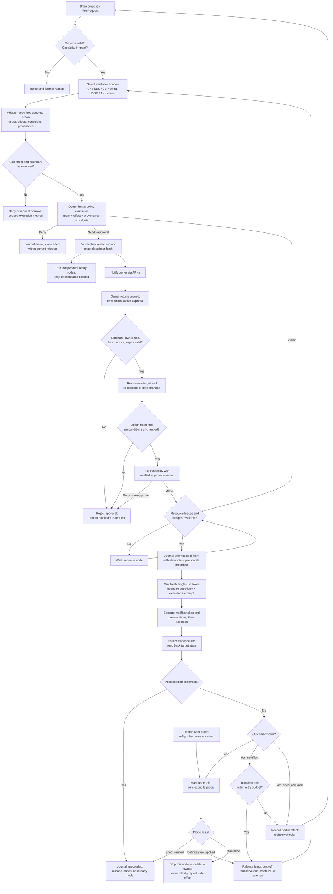

# Command execution flow

Every concrete action is described, authorized **at execution time**, journaled, executed with a fresh single-use capability token, and verified. An owner approval is not a bypass: Core verifies it, re-describes the action if needed, and **re-runs policy with the approval attached**.

Retries of side-effecting actions are never sent straight back to an executor. Known-safe retries re-enter descriptor resolution, policy, resource checks, and token minting. Unknown outcomes go through reconciliation first.

## Invariants for implementers

1. Approval validates a **specific canonical ActionDescriptor**, not just a high-level intent. If the recipient, payload, target, or preconditions change, the owner must approve the new action.
2. The approval re-enters the policy engine. Owner approval can satisfy an approvable rule; it cannot override a hard deny or an OS authentication barrier.
3. Capability tokens are **single-use and attempt-bound**. A retry must be freshly described, authorized, journaled, and tokenized.
4. The executor checks the token itself; the tool router is not the enforcement boundary. Restrict direct executor entry points.
5. A postcondition failure is not automatically proof an action failed. Especially for sends, pushes, purchases, and deletes, an uncertain outcome requires a read-back/reconcile probe or human resolution.
6. A policy deny closes an **effect**, not every alternative implementation of a permitted goal. An out-of-scope effect cannot be retried via another tool.
7. The graph shows the logical protocol, not proof of macOS process or network containment; enforcement must pass the tests in the roadmap.
