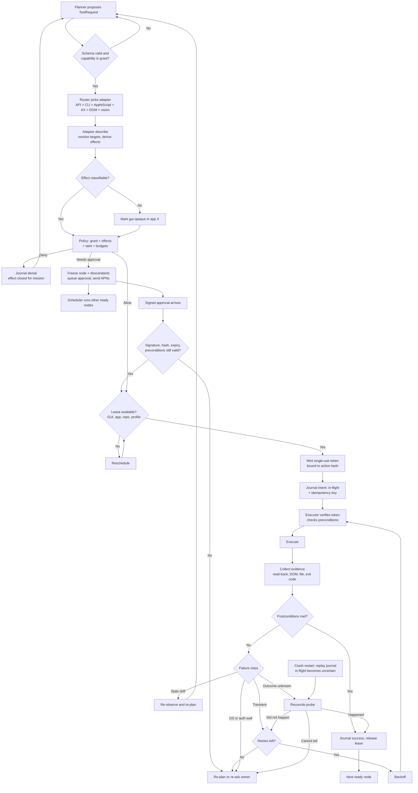

# Command execution flow

Every action passes schema, adapter description, policy, lease, token, execution, and postcondition checks, with explicit paths for retries, drift, crashes, and approvals.

