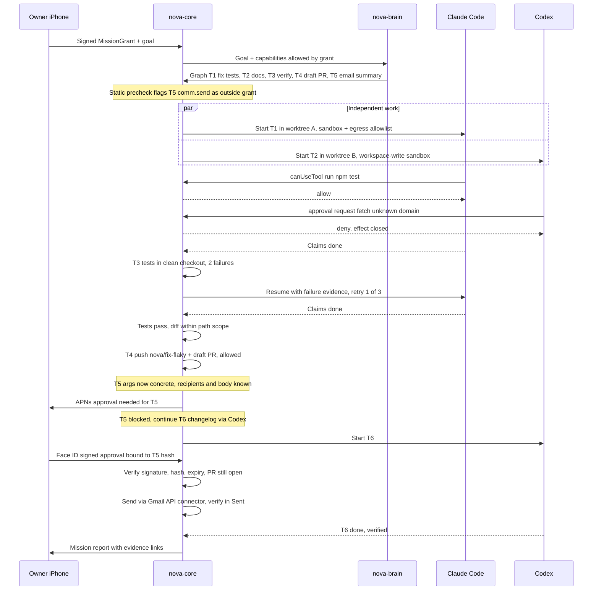

# Unattended supervision with an approval blocker

Nova fixes flaky tests with Claude Code, updates docs with Codex, opens a draft PR, and waits for approval only on the summary email, which the grant doesn't cover. The grant covers worktrees, tests, pushes to `nova/*` branches, and draft PRs.

